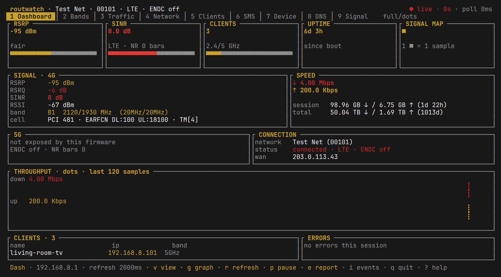
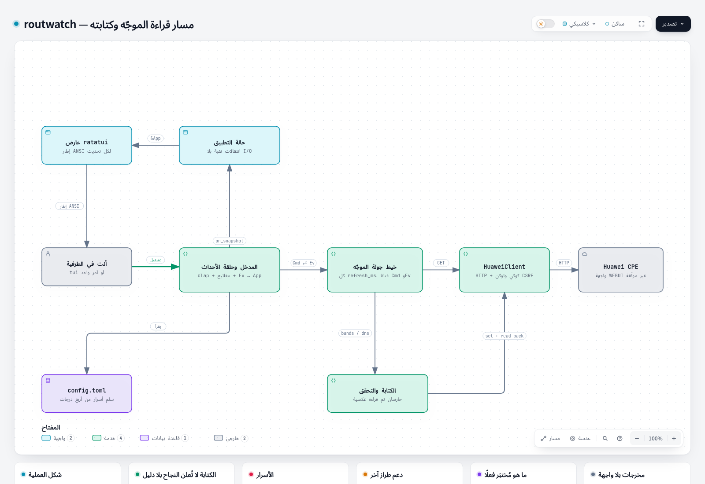
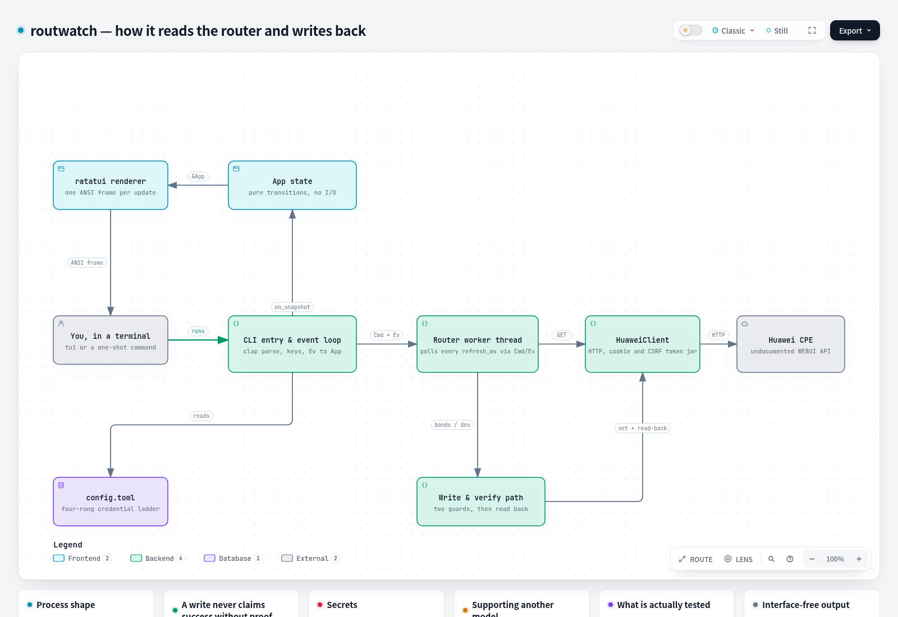
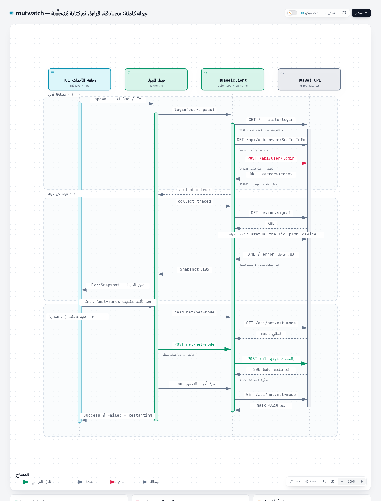
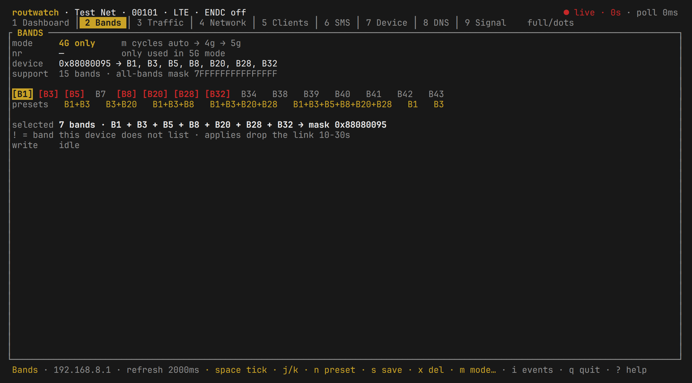

<p align="center">
  <h1 align="center">routwatch</h1>
  <p align="center"><strong>Huawei LTE/5G CPE manager in the terminal.</strong></p>
  <p align="center">
    
    
    
  </p>
</p>

routwatch is the fourth member of the `syswatch` / `netwatch` / `diskwatch`
family: same config file shape, same themes, same keys. It talks to a Huawei
CPE (tested on the H122-373, WEBUI 11.0.2.21) over its own HTTP API and gives
you signal, traffic, clients, bands, DNS and device state in one screen - plus
a headless mode for Waybar and scripts.



Every screenshot here is rendered from `fixtures/sample-snapshot*.json` with
`routwatch preview --ansi`, so it is synthetic: device names, MACs, WAN address and
identifiers are placeholders. The remaining seven sections are in
[`docs/screenshots/more/`](docs/screenshots/more).

## Visual maps

Two maps of the codebase, in English and Arabic: one for the architecture, one
for a single fetch cycle. Both were generated from commit `2ef59c9`, and every
claim drawn inside the HTML carries the source line it came from. Each image
below links to the interactive map it belongs to.

| Arabic | English |
|---|---|
| [](docs/diagrams/routwatch-architecture.html) | [](docs/diagrams/routwatch-architecture.en.html) |
| [](docs/diagrams/routwatch-sequence.html) | [](docs/diagrams/routwatch-sequence.en.html) |

The HTML files are interactive and open locally: download the file and open it in
a browser, with no server, no install and no account. [`docs/diagrams/`](docs/diagrams)
lists all eight files.

## Install

| Route | Command |
|---|---|
| Arch package, no build | `curl -LO https://github.com/root-secyrity/routwatch/releases/download/v0.2.3/routwatch-0.2.3-1-x86_64.pkg.tar.zst && sudo pacman -U routwatch-0.2.3-1-x86_64.pkg.tar.zst` |
| Static musl binary | [routwatch-x86_64-linux-musl](https://github.com/root-secyrity/routwatch/releases/latest/download/routwatch-x86_64-linux-musl) - a permanent link, links nothing, runs on Arch, Debian, Ubuntu, Fedora, Alpine, Raspberry Pi OS |
| Any distro, from source | `git clone https://github.com/root-secyrity/routwatch.git && cd routwatch && sudo make install` (or `PREFIX=$HOME/.local`) |
| Build the static binary | `./packaging/musl-build.sh` - needs docker, writes `dist/` |
| Windows 10/11, via WSL2 | no separate build: `wsl --install -d Ubuntu`, then install the static musl binary inside it ([details](#windows)) |

The package is unsigned, so pass pacman a **downloaded file**: `pacman -U <url>`
asks for a detached `.sig` that does not exist and aborts with a 404 on a default
`SigLevel = Required` system. Downloading first keeps the install local, where the
file is what it is.

`make install` also writes bash, zsh and fish completions, generated by the binary
it just built, so they cannot drift from the flags this build accepts. Package
users get the same scripts from `routwatch --completion <shell>`.

Rust **1.88+** is required and the distributions ship older compilers (Debian 12
has 1.63, Ubuntu 22.04 has 1.66, Fedora 41 has 1.82), so install rustup before
building from source. Arch users can also build either recipe: `packaging/PKGBUILD`
(`routwatch-git`) or `packaging/PKGBUILD.release` (`routwatch`), with
`cd packaging && makepkg -si`.

A binary built against a distribution's glibc needs that glibc or newer: Debian 12
and Ubuntu 22.04 need nothing past `GLIBC_2.34`, while building on Arch adds a
*weak* `GLIBC_2.39` reference that older loaders warn about once. The musl build
has no such floor.

## Tested on

The router side is what varies: routwatch speaks an undocumented HTTP API, so the
firmware decides whether a panel fills, not the distribution.

| Router | WebUI / firmware | What was verified |
|---|---|---|
| Huawei H122-373 | 11.0.2.21 | every section, the bands and DNS write path with its read-back, the headless commands, the report export |
| any other Huawei CPE | - | **untested** |

An untested model is not a refusal. The read path is generic: every endpoint is
probed, and a firmware that does not implement one answers with its own error
code, so the panel that reads it says what is missing instead of guessing. The
write path is the part most likely to differ per firmware - it prints both sides
before it sends anything and reads the router back afterwards.

If you run it on another model, open a
[model report](https://github.com/root-secyrity/routwatch/issues/new?template=model_report.yml)
with the output of `routwatch doctor --json` - it names each capability as
`ready` / `degraded` / `failed` and carries the firmware's own reason for each
failure.

## Supported Linux

| Distribution | Verified | Notes |
|---|---|---|
| Arch / CachyOS / Manjaro | built, packaged, installed and run on this machine | `packaging/PKGBUILD` |
| Debian 12 (bookworm) | built in a clean container; binary runs and renders | needs no symbol newer than `GLIBC_2.34`, no loader warning |
| Ubuntu 22.04 | built in a clean container; binary runs and renders | same result as Debian 12 |
| Fedora 41 | built in a clean container; binary runs | same source, no patches |
| Alpine 3.20 (musl) | built in a clean container; **static** binary runs on Arch | `packaging/musl-build.sh` |
| Ubuntu 24.04 | covered by the CI matrix (`.github/workflows/ci.yml`) | |

Optional helpers differ per distribution, and a missing one never breaks
routwatch - `routwatch doctor --json` reports a `helpers` capability instead:

| Helper | Package | Used for |
|---|---|---|
| `ping` | `iputils-ping` (Debian/Ubuntu) · `iputils` (Arch/Fedora) · busybox (Alpine) | Network tab ping, `routwatch ping` |
| `wl-copy` / `xclip` / `xsel` | `wl-clipboard` · `xclip` · `xsel` | copying a client MAC (first one found wins) |
| `secret-tool` | `libsecret-tools` (Debian/Ubuntu) · `libsecret` (Arch) | password keyring (falls back to env/config) |

## Windows

No native `routwatch.exe` is shipped. Inside WSL2 the same static binary runs
unmodified:

```sh
# once, in PowerShell, then reboot
wsl --install -d Ubuntu

# inside Ubuntu, the permanent link: it always points at the newest binary
curl -LO https://github.com/root-secyrity/routwatch/releases/latest/download/routwatch-x86_64-linux-musl
sudo install -m 755 routwatch-x86_64-linux-musl /usr/local/bin/routwatch
routwatch doctor --json
```

Two things break on Windows, both silent until you hit them:

- Keep `~/.config/routwatch/config.toml` inside the WSL filesystem, not under
  `/mnt/c`. DrvFs mounts files `0777`, and routwatch refuses any config the group
  can read (`is mode 777; run chmod 600`), which `chmod` cannot fix there without a
  `metadata` mount option.
- Run it in Windows Terminal. The legacy console host has no truecolor, so the
  theme and the colour-coded panels degrade.

## Configure

```sh
routwatch --generate-config    # writes ~/.config/routwatch/config.toml at 0600
```

```toml
[router]
ip = "192.168.8.1"
username = "admin"
# password is optional here - prefer ROUTWATCH_PASSWORD or secret-tool
password = ""

[app]
refresh_ms = 2000
timeout_ms = 3000
theme = "terminal"      # follows your terminal / desktop theme
view = "full"           # full · gauges · lite · dense
graph_style = "dots"    # dots · bars · braille
budget_gb = 100         # local budget only; this firmware reports no monthly quota
```

The password ladder is `--password-stdin` → `ROUTWATCH_PASSWORD` → `secret-tool`
→ `config.toml`, and the file is refused unless it is `0600`.

## Keys

| Key | Where | Action |
|---|---|---|
| `1`–`9` | everywhere | jump to a section (works from any view) |
| `Tab` / `Shift+Tab` | everywhere | next / previous section |
| `v` `V` | everywhere | cycle view: full → gauges → lite → dense |
| `l` `L` | everywhere | toggle lite, returning to the view you came from |
| `g` `r` `p` | everywhere | graph style · refresh now · pause polling |
| `,` or `s` | everywhere | settings overlay (theme, view, graph, refresh, budget); `w` saves |
| `i` | everywhere | event feed: `j`/`k` select, `space` pause/resume, `Esc` or `i` closes |
| `?` | everywhere | key help |
| `space` `j` `k` | Bands | tick a band · move (inside the event feed they belong to the feed) |
| `n` `s` `x` | Bands | next merge preset · save the ticked merge · delete preset |
| `m` `o` `a` | Bands | network mode · NR option · apply (confirm with `y`) |
| `d` `z` | Traffic/DNS | type DNS servers · back to DHCP |
| `j` `k` `Enter` | DNS | choose a preset · apply (confirm with `y`) |
| `t` | Network | ping a host from this machine |
| `s` `c` | Clients | sort (name/ip/band/time) · copy MAC |
| `e` / `R` | SMS/Device | read extras (inbox, SIM, data switch) |
| `x` `b` | Device | dump all endpoints to JSON · restart router (type `REBOOT`) |
| `e` | every section except SMS/Device | write a Markdown report to `~/.local/share/routwatch/reports/` |
| `i` | settings overlay (`,`) | switch the report between `redacted` (default) and `full` |

Every section lists its own keys in the status bar, and `e` stays "read extras" on
SMS and Device, where the inbox is what you want. The event feed is a window over
the session log (up to 200 lines, newest at the top) and its selection is counted
from the newest, so a line arriving while you read cannot slide the text out from
under you; moving pauses the feed, because following would undo your scroll on the
next poll. The header names the session state (`● live`, `● recovering #3 8s`,
`● disconnected`), `paused`, the age of the last sample (`stale 45s`) and, while a
scan runs, the endpoint being read (`✓ plmn 3/10`); on a narrow terminal the state
is the last thing dropped.

## Bands, with merge presets

Select several bands (`space`), save the combination as a preset (`s`), and cycle
the ready-made ones with `n`. Nothing is sent until `a` and `y`.



Presets live in `~/.config/routwatch/config.toml` (`[[app.presets]]`). No
`presets` key means the five built-ins; `presets = []` means you deleted them and
mean it.

## Headless

```sh
routwatch status --waybar
# {"text":"LTE ▄ -96dBm","tooltip":"Test Net (00101)\nLTE · ENDC off · 5 bars\n…","class":"fair","percentage":46}

routwatch snapshot --json
routwatch doctor --json          # capabilities with state/reason/detail/next_check
routwatch dump --json            # every raw endpoint → routwatch-dump.json in $PWD
routwatch share                  # one file: capabilities, endpoint field names,
                                 # redacted snapshot - the ask-for-a-model document
```

Waybar module:

```jsonc
"custom/routwatch": {
  "exec": "routwatch status --waybar",
  "interval": 5,
  "return-type": "json",
  "on-click": "kitty -e routwatch"
}
```

Exit codes: `0` ok · `2` network/unreachable (the Waybar document still prints,
`class: "offline"`) · `3` credentials or config.

Identity never leaves by accident: `snapshot --json --redact` replaces serial,
IMEI, MACs, WAN IP and client names with `(hidden)`, `dump --redact` does the same
to the raw XML (keeping every tag name), and `snapshot --raw --redact` is refused
outright rather than pretending to be safe. `routwatch share` writes the whole
ask-for-a-model document - capabilities, endpoint field names, redacted snapshot -
as `0600` in the current directory.

## Themes

Eight, identical to the rest of the family and byte-for-byte the same palettes:
`dark`, `terminal` (default - follows your terminal palette), `ocean`,
`solarized`, `dracula`, `nord`, `sky`, `paper` (the last two paint their own panel
background). Aliases: `system`/`ansi` → `terminal`, `light`/`minimal` → `paper`.
Pick one with `--theme <name>` or cycle with `t` in the settings overlay.

`auto` is not a ninth palette: it follows whatever the running desktop publishes
and falls back to `terminal` when there is nothing to read. The ladder is
`$ROUTWATCH_THEME_FILE` → the running Ryoku desktop's `theme.name` +
`scheme.json` → an Omarchy `colors.toml` → `terminal`. The desktop that is
actually running wins, because a Ryoku box also carries an Omarchy-compatible copy
that can be stale. Every derived palette is checked for 4.5:1 body contrast.

```sh
ROUTWATCH_THEME_FILE=~/mine.toml routwatch --theme auto
routwatch preview --tab bands --size 120x30 --ansi
```

## Safety

- Reads are free; **writes are confirmed** and verified by reading the router back
  (`mask verified`), so a silent revert is visible.
- Band/DNS/restart changes need the in-TUI `a` → `y` confirmation, or
  `--allow-write` on the CLI. `--dry-run` prints the exact payload and sends nothing.
- Band changes drop the link for 10–30 seconds. The UI says so before you do it.

## Limits (stated, not hidden)

- **SMS** is blocked by the firmware (`100005`); the tab shows counters and says so.
- **5G per-field metrics** (`nrrsrp`, `nrsinr`, `nrdlmcs`) are empty on some
  firmware even with ENDC active. Only `SignalIconNr` (0–5 bars) and the ENDC flag
  are reliable there; the UI switches to a bars panel instead of faking dBm.
- **No monthly quota**: this firmware answers `100003`. The budget bar is local.
- **Reports are redacted unless you ask**: `e` writes `0600` Markdown in a `0700`
  directory, with IMEI, serial, WAN IP, MACs and SSIDs hidden - these files get
  pasted in public. `report_identity`, `--report-identity` or `i` in the settings
  overlay writes the full version, and a report never overwrites another.
- **`auto` theme is best-effort**: it reads the running desktop's published colours
  and falls back to `terminal`. The default is still `terminal`, so no machine
  changes appearance unasked.
- **Instrument band**: the dashboard shows RSRP, SINR, clients and a signal map on
  rows 3–9. `UPTIME` and `TEMP` appear only when the router reports them, and the
  band re-flows to four, five or six equal cells instead of leaving a hole. It
  needs 27 body rows; below that the dashboard blocks keep the space.
- **Small terminals**: the frame degrades in a fixed order instead of clipping. The
  tab bar becomes `1/9 Dash · Tab next` below 12 rows or 76 columns; below 60
  columns the status line keeps one fact plus the keys, below 40 only the keys; the
  dashboard drops from four blocks to signal + speed + history (under 25 rows) and
  to one signal panel at the 24x6 floor, where `too small` names the size it needs.

## Development

```sh
cargo test                 # 182 unit + 3 binary + 9 CLI tests, no router and no fixtures on disk
cargo clippy --all-targets # zero warnings
cargo fmt --check
```

`docs/contracts.md` lists the promises a future change could quietly break - "a
confirming write never hides the outage", "the feed keeps your place" - each with
the test that fails when it is broken. The table is machine-checked
(`src/contracts.rs`), so renaming a guard fails the build instead of retiring the
promise.

## Credits and prior art

routwatch is the fourth member of the family that already had
[netwatch](https://github.com/matthart1983/netwatch) (real-time network
diagnostics), [syswatch](https://github.com/matthart1983/syswatch) (system, twelve
tabs) and [diskwatch](https://github.com/matthart1983/diskwatch) (disk, eight
tabs) - all three by [Matt Hartley (matthart1983)](https://github.com/matthart1983),
all three MIT, and the explicit inspiration here: the
`~/.config/<tool>/config.toml` shape, `theme = "terminal"`, the `V`/`L` view
cycle, `--tab`/`--graph`, the `doctor --json` capability schema and the habit of
stating a limitation instead of showing a plausible zero. The eight palettes in
`src/theme.rs` are derived byte-for-byte from netwatch's theme module (slot names
are ours, the colour values are not), so a theme looks identical whichever of the
four tools you open.

The feature set and the router knowledge come from **HManagerPy 2.1.0**, the
Electron application this replaces, written by RoOt-SeC. See [NOTICE](NOTICE) for
the complete attribution and the reproduced MIT text.

## License

MIT - see [LICENSE](LICENSE) and [NOTICE](NOTICE).
