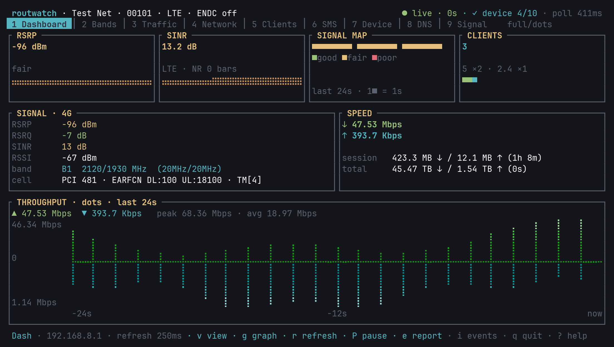
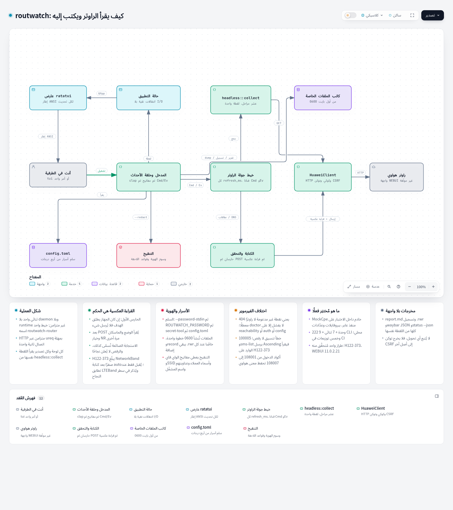
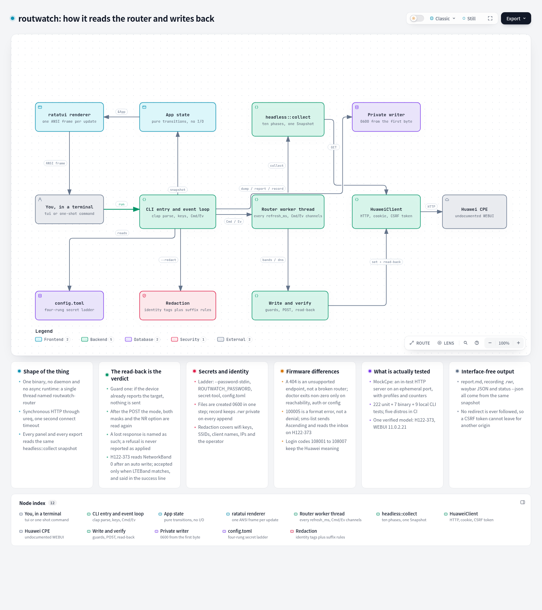
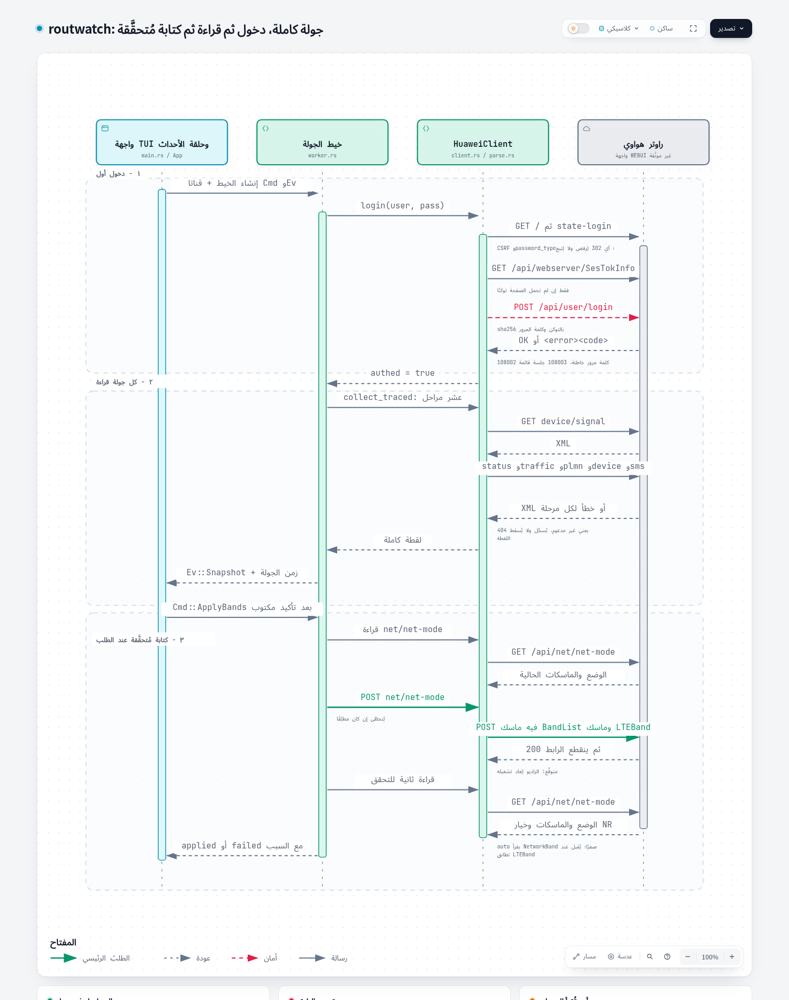
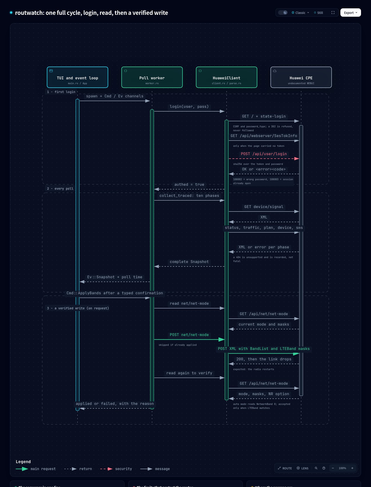

<p align="center">
  <h1 align="center">routwatch</h1>
  <p align="center"><strong>Huawei LTE/5G CPE manager in the terminal.</strong></p>
  <p align="center">
    
    
    
  </p>
</p>

routwatch is the fourth member of the `syswatch` / `netwatch` / `diskwatch`
family: same config file shape, same themes, same keys. It talks to a Huawei
CPE (tested on the H122-373, WEBUI 11.0.2.21) over its own HTTP API and gives
you signal, traffic, clients, bands, DNS and device state in one screen - plus
a headless mode for Waybar and scripts.



Every screenshot here is rendered from `fixtures/sample-snapshot*.json` with
`routwatch preview --ansi`, so it is synthetic: device names, MACs, WAN address and
identifiers are placeholders. The remaining seven sections are in
[`docs/screenshots/more/`](docs/screenshots/more).

## Install

| Route | Command |
|---|---|
| Arch package, no build | `curl -LO https://github.com/root-secyrity/routwatch/releases/download/v0.5.0/routwatch-0.5.0-1-x86_64.pkg.tar.zst && sudo pacman -U routwatch-0.5.0-1-x86_64.pkg.tar.zst` |
| Static musl binary | [routwatch-x86_64-linux-musl](https://github.com/root-secyrity/routwatch/releases/latest/download/routwatch-x86_64-linux-musl) - links nothing, runs on Arch, Debian, Ubuntu, Fedora, Alpine, Raspberry Pi OS |
| Any distro, from source | `git clone https://github.com/root-secyrity/routwatch.git && cd routwatch && sudo make install` |
| Windows 10/11, via WSL2 | no separate build: install the static binary inside WSL ([details](docs/platforms.md#windows)) |

The package is unsigned, so download the file before handing it to `pacman`
(passing a URL makes it look for a `.sig` that does not exist).
[`docs/install.md`](docs/install.md) has the rest: the musl build script, the
completions, the MSRV 1.88 floor and the glibc notes.

## Run it

```sh
routwatch --generate-config    # ~/.config/routwatch/config.toml at 0600
$EDITOR ~/.config/routwatch/config.toml
routwatch
```

Then `?` for the keys and `,` for the settings overlay. Reads are free; writes
need `a` then `y` (see [Safety](#safety)).

## Does it work with my router?

| Router | WebUI / firmware | What was verified |
|---|---|---|
| Huawei H122-373 | 11.0.2.21 | every section, the bands and DNS write path with its read-back, the headless commands, the report export |
| any other Huawei CPE | - | **untested** |

An untested model is not a refusal: the read path probes every endpoint and names
the ones the firmware refuses, so a panel says what is missing instead of
guessing, and the write path prints both sides before it sends anything. If you run
it on another model, open a
[model report](https://github.com/root-secyrity/routwatch/issues/new?template=model_report.yml)
with `routwatch doctor --json`; it becomes a mock profile and a test, so your
router ends up covered by CI. Distributions and optional helpers are listed in
[`docs/platforms.md`](docs/platforms.md).

## Visual maps

Two maps of the codebase, in English and Arabic: one for the architecture, one
for a single fetch cycle. Both are generated with Archify from the source at
commit `a2610eed97dbc879ebfa30f49ef38db7d05e3d4a`, and every claim drawn inside the HTML carries the source line it
came from.

| Arabic | English |
|---|---|
| [](docs/diagrams/routwatch-architecture.html) | [](docs/diagrams/routwatch-architecture.en.html) |
| [](docs/diagrams/routwatch-sequence.html) | [](docs/diagrams/routwatch-sequence.en.html) |

The HTML files are interactive and open locally: download the file and open it in
a browser, with no server, no install and no account. [`docs/diagrams/`](docs/diagrams)
lists all eight files.

## Documentation

Everything longer than this page lives in [`docs/`](docs/README.md), one file per
question.

| If you want to | Read |
|---|---|
| install it, and write the config file | [`docs/install.md`](docs/install.md) |
| know whether your router or distribution is covered | [`docs/platforms.md`](docs/platforms.md) |
| look up a key while the TUI is open | [`docs/keys.md`](docs/keys.md) |
| change bands, or save a band combination | [`docs/bands.md`](docs/bands.md) |
| put it in Waybar, or script against `--json` | [`docs/headless.md`](docs/headless.md) |
| change the colours | [`docs/themes.md`](docs/themes.md) |
| know what does not work, and why | [`docs/limits.md`](docs/limits.md) |
| know who wrote what | [`docs/credits.md`](docs/credits.md) · [`NOTICE`](NOTICE) |
| contribute, or read the promises a change must keep | [`CONTRIBUTING.md`](CONTRIBUTING.md) · [`docs/contracts.md`](docs/contracts.md) |

## Safety

- Reads are free; **writes are confirmed** and verified by reading the router back
  (`mask verified`), so a silent revert is visible.
- Band/DNS/restart changes need the in-TUI `a` → `y` confirmation, or
  `--allow-write` on the CLI. `--dry-run` prints the exact payload and sends nothing.
- Band changes drop the link for 10–30 seconds. The UI says so before you do it.

## Limits, the short list

- **5G per-field metrics can be empty** on some firmware: the signal panel shows
  the bars and says which `nr` fields did arrive rather than inventing dBm.
- **The budget starts at a baseline**: `budget_gb` is compared against traffic
  since a baseline that `b` resets and the billing cycle moves. The router's own
  month counter is used when the firmware answers it; otherwise the lifetime
  counters are. The per-day table only counts while routwatch runs.
- **Reports are redacted unless you ask**: `e` writes `0600` Markdown with IMEI,
  serial, WAN IP, MACs and SSIDs hidden, because these files get pasted in public.

Eight more, including the `100006` band-write code, the small-terminal order and
the graph colour floor, are stated in [`docs/limits.md`](docs/limits.md). Nothing
there is a wish list: each entry is something a firmware or a terminal actually
did.

## Development

`make build`, `make test`, `make lint`, `make fmt`; a change is ready when all four
are clean. The test count, the CI matrix and the rules for a change are in
[`CONTRIBUTING.md`](CONTRIBUTING.md). `docs/contracts.md` lists the promises a
future change could quietly break, each with the test that fails when it is
broken; the table is machine-checked by `src/contracts.rs`.

## Credits and prior art

routwatch follows three MIT tools by
[Matt Hartley (matthart1983)](https://github.com/matthart1983) -
[netwatch](https://github.com/matthart1983/netwatch),
[syswatch](https://github.com/matthart1983/syswatch) and
[diskwatch](https://github.com/matthart1983/diskwatch) - for the config shape,
the theme palettes and the `doctor --json` schema. The feature set and the router
knowledge come from **HManagerPy 2.1.0**, written by RoOt-SeC. The full
attribution, including the reproduced MIT text, is in [`NOTICE`](NOTICE) and
[`docs/credits.md`](docs/credits.md).

## License

MIT - see [LICENSE](LICENSE) and [NOTICE](NOTICE).
