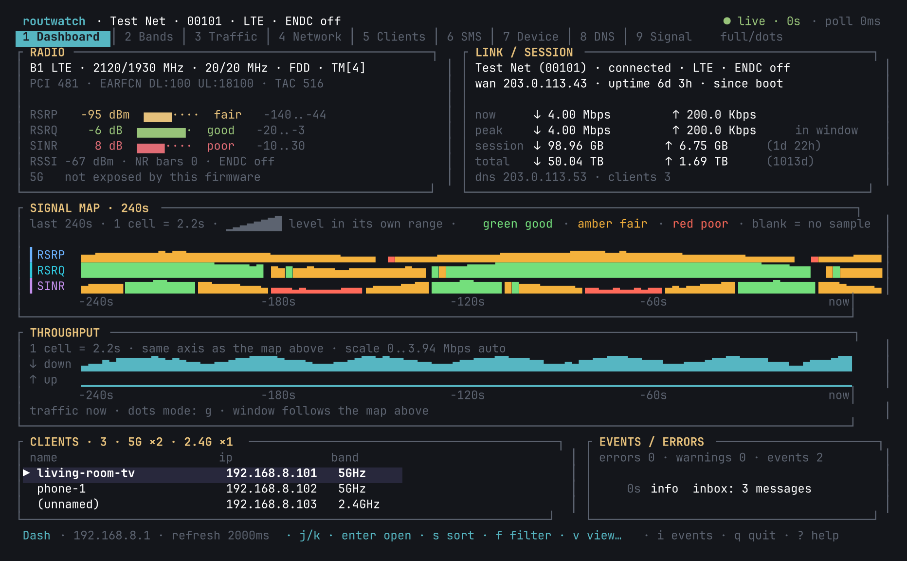
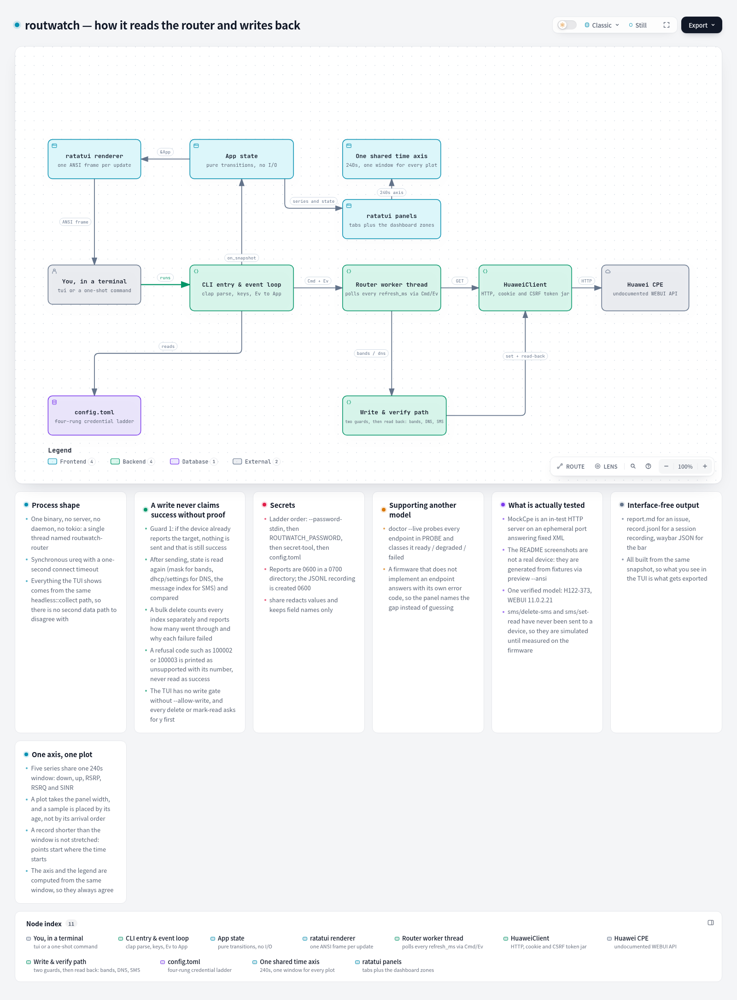
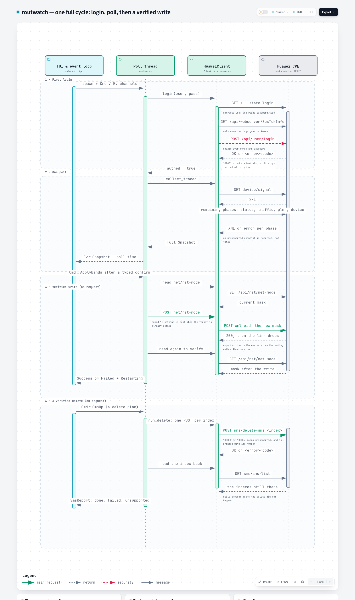

<p align="center">
  <h1 align="center">routwatch</h1>
  <p align="center"><strong>Huawei LTE/5G CPE manager in the terminal.</strong></p>
  <p align="center">
    
    
    
  </p>
</p>

routwatch is the fourth member of the `syswatch` / `netwatch` / `diskwatch`
family: same config file shape, same themes, same keys. It talks to a Huawei
CPE (tested on the H122-373, WEBUI 11.0.2.21) over its own HTTP API and gives
you signal, traffic, clients, bands, DNS and device state in one screen - plus
a headless mode for Waybar and scripts.



Every screenshot here is rendered from `fixtures/sample-snapshot*.json` with
`routwatch preview --ansi`, so it is synthetic: device names, MACs, WAN address and
identifiers are placeholders. The remaining seven sections are in
[`docs/screenshots/more/`](docs/screenshots/more).

## Install

| Route | Command |
|---|---|
| Arch package, no build | `curl -LO https://github.com/root-secyrity/routwatch/releases/download/v0.8.0/routwatch-0.8.0-1-x86_64.pkg.tar.zst && sudo pacman -U routwatch-0.8.0-1-x86_64.pkg.tar.zst` |
| Static musl binary | [routwatch-x86_64-linux-musl](https://github.com/root-secyrity/routwatch/releases/latest/download/routwatch-x86_64-linux-musl) - links nothing, runs on Arch, Debian, Ubuntu, Fedora, Alpine, Raspberry Pi OS |
| Any distro, from source | `git clone https://github.com/root-secyrity/routwatch.git && cd routwatch && sudo make install` |
| Windows 10/11, via WSL2 | no separate build: install the static binary inside WSL ([details](docs/platforms.md#windows)) |

The package is unsigned, so download the file before handing it to `pacman`
(passing a URL makes it look for a `.sig` that does not exist).
[`docs/install.md`](docs/install.md) has the rest: the musl build script, the
completions, the MSRV 1.88 floor and the glibc notes.

## Run it

```sh
routwatch --generate-config    # ~/.config/routwatch/config.toml at 0600
$EDITOR ~/.config/routwatch/config.toml
routwatch
```

Then `?` for the keys and `,` for the settings overlay. Reads are free; writes
need `a` then `y` (see [Safety](#safety)).

## The dashboard, seven zones

One screen, one figure each: the serving cell and its meters, the link and the
session, a signal map over the last four minutes, the same window for
throughput, the clients, the events, and the status row. The frame below is
`routwatch preview --size 120x42 --fixture fixtures/sample-snapshot.json`, so
every value in it is synthetic.

```text
 routwatch · Test Net · 00101 · LTE · ENDC off                                                   ● live · 0s · poll 0ms 
 1 Dashboard │ 2 Bands │ 3 Traffic │ 4 Network │ 5 Clients │ 6 SMS │ 7 Device │ 8 DNS │ 9 Signal    full/braille        
┌ RADIO ───────────────────────────────────────────────────┐ ┌ LINK / SESSION ─────────────────────────────────────────┐
│ B1 LTE · 2120/1930 MHz · 20/20 MHz · FDD · TM[4]         │ │ Test Net (00101) · connected · LTE · ENDC off           │
│ PCI 481 · EARFCN DL:100 UL:18100 · TAC 516               │ │ wan 203.0.113.43 · uptime 6d 3h · since boot            │
│                                                          │ │                                                         │
│ RSRP   -95 dBm  ▅▅▅▅····  fair  -140..-44                │ │ now     ↓ 4.00 Mbps        ↑ 200.0 Kbps                 │
│ RSRQ    -6 dB  ▅▅▅▅▅▅▅·  good  -20..-3                   │ │ peak    ↓ 4.00 Mbps        ↑ 200.0 Kbps     in window   │
│ SINR     8 dB  ▅▅▅▅····  poor  -10..30                   │ │ session ↓ 98.96 GB        ↑ 6.75 GB     (1d 22h)        │
│ RSSI -67 dBm · NR bars 0 · ENDC off                      │ │ total   ↓ 50.04 TB        ↑ 1.69 TB     (1013d)         │
│ 5G   not exposed by this firmware                        │ │ dns 203.0.113.53 · clients 3                            │
└──────────────────────────────────────────────────────────┘ └─────────────────────────────────────────────────────────┘
┌ SIGNAL MAP · 240s ───────────────────────────────────────────────────────────────────────────────────────────────────┐
│ last 240s · 1 cell = 3s · ▓ good  ▒ fair  ░ poor  · blank = no sample                                                │
│                                                                                                                      │
│ RSRP                                                                                   ▒  min -95 · avg -95 · max -95│
│ RSRQ                                                                                   ▓  min -6 · avg -6 · max -6   │
│ SINR                                                                                   ░  min 8 · avg 8 · max 8      │
│                                                                                                                      │
│ -240s                       -180s                       -120s                        -60s                         now│
│                                                                                                                      │
└──────────────────────────────────────────────────────────────────────────────────────────────────────────────────────┘
┌ THROUGHPUT ──────────────────────────────────────────────────────────────────────────────────────────────────────────┐
│ 1 cell = 3s · same axis as the map above · scale 0..4.00 Mbps auto                                                   │
│                                                                                                                      │
│ ↓ down                                                                                 █         pk 4.0M · avg 4.0M  │
│ ↑ up                                                                                   ▁         pk 200K · avg 200K  │
│ -240s                       -180s                       -120s                        -60s                         now│
│ traffic now · window follows the map above                                                                           │
└──────────────────────────────────────────────────────────────────────────────────────────────────────────────────────┘
┌ CLIENTS · 3 · 5G ×2 · 2.4G ×1 ────────────────────────────────────────────┐ ┌ EVENTS / ERRORS ───────────────────────┐
│ name                       ip              band    connected              │ │ errors 0 · warnings 0 · events 1       │
│▶ living-room-tv             192.168.8.101   5GHz    4d 11h                │ │                                        │
│  phone-1                    192.168.8.102   5GHz    0s                    │ │     0s info  session live · Test Net ·…│
│  (unnamed)                  192.168.8.103   2.4GHz  11h 39m               │ │                                        │
│ j/k move · enter opens a client · s sort · f filter · 3 of 3 shown        │ │                                        │
│                                                                           │ │                                        │
│                                                                           │ │                                        │
│                                                                           │ │                                        │
│                                                                           │ │                                        │
└───────────────────────────────────────────────────────────────────────────┘ └────────────────────────────────────────┘
 Dash · 192.168.8.1 · refresh 2000ms · j/k · enter open · s sort · f filter · v view… · i events · q quit · ? help      
```

The two plots share one time axis: the window is always 240 seconds and every
column the width leaves is a cell, so the cell widens on a narrow terminal
(3.4s at 80 columns, 1.5s at 200) and the newest sample lands in the same
column in both. The legend prints the span the columns actually have. A cell carries the worst sample it holds (the lowest
for RSRP, RSRQ and SINR, the peak for traffic) and a blank cell means no sample
was taken, never a good one. `j`/`k` move over the clients, `enter` opens the
selected one on the Clients tab, `s` sorts and `f` filters by band. The
statistics column beside the map appears from 110 columns up.

## Does it work with my router?

| Router | WebUI / firmware | What was verified |
|---|---|---|
| Huawei H122-373 | 11.0.2.21 | every section, the bands and DNS write path with its read-back, the headless commands, the report export |
| any other Huawei CPE | - | **untested** |

An untested model is not a refusal: the read path probes every endpoint and names
the ones the firmware refuses, so a panel says what is missing instead of
guessing, and the write path prints both sides before it sends anything. If you run
it on another model, open a
[model report](https://github.com/root-secyrity/routwatch/issues/new?template=model_report.yml)
with `routwatch doctor --json`; it becomes a mock profile and a test, so your
router ends up covered by CI. Distributions and optional helpers are listed in
[`docs/platforms.md`](docs/platforms.md).

## Visual maps

Two maps of the codebase, in English and Arabic: one for the architecture, one
for a fetch cycle and the two verified writes it can carry (a band mask, an SMS
delete). Both are generated with Archify from the source at
commit `89e79313001eaba7698d54b1da27babdd265521d`, and every claim drawn inside the HTML carries the source line it
came from.

| Arabic | English |
|---|---|
| [](docs/diagrams/routwatch-architecture.html) | [](docs/diagrams/routwatch-architecture.en.html) |
| [](docs/diagrams/routwatch-sequence.html) | [](docs/diagrams/routwatch-sequence.en.html) |

The HTML files are interactive and open locally: download the file and open it in
a browser, with no server, no install and no account. [`docs/diagrams/`](docs/diagrams)
lists all eight files.

## Documentation

Everything longer than this page lives in [`docs/`](docs/README.md), one file per
question.

| If you want to | Read |
|---|---|
| install it, and write the config file | [`docs/install.md`](docs/install.md) |
| know whether your router or distribution is covered | [`docs/platforms.md`](docs/platforms.md) |
| look up a key while the TUI is open | [`docs/keys.md`](docs/keys.md) |
| change bands, or save a band combination | [`docs/bands.md`](docs/bands.md) |
| put it in Waybar, or script against `--json` | [`docs/headless.md`](docs/headless.md) |
| change the colours | [`docs/themes.md`](docs/themes.md) |
| know what does not work, and why | [`docs/limits.md`](docs/limits.md) |
| know who wrote what | [`docs/credits.md`](docs/credits.md) · [`NOTICE`](NOTICE) |
| contribute, or read the promises a change must keep | [`CONTRIBUTING.md`](CONTRIBUTING.md) · [`docs/contracts.md`](docs/contracts.md) |

## Safety

- Reads are free; **writes are confirmed** and verified by reading the router back
  (`mask verified`), so a silent revert is visible.
- Band/DNS/restart changes need the in-TUI `a` → `y` confirmation, or
  `--allow-write` on the CLI. `--dry-run` prints the exact payload and sends nothing.
- Pressing `d` (or `m`) opens a confirmation panel that lists the indexes it will
  touch and warns that a deleted message cannot be recovered; `y` sends, `n` or
  `Esc` cancels without a POST.
- The TUI itself starts read-only: `routwatch --allow-write` is what opens the write
  keys (Bands `a`, SMS `d` and `m`). Without it those keys answer
  `writes are off: start with --allow-write` and send nothing.
- Band changes drop the link for 10–30 seconds. The UI says so before you do it.

## SMS: read, mark read, delete

Section 6 lists the inbox with a cursor and a selection, and opens a message in a
wrapped reader underneath (`Enter`, `Esc` to close). Opening writes nothing: no
read receipt, no POST.

```sh
routwatch sms list                 # inbox, page by page, full text per row
routwatch sms list --folder draft --json --limit 50
routwatch sms read 4001            # the body on stdout, uncut
routwatch sms delete 4001 --allow-write --yes
routwatch sms delete --all --allow-write        # prints the plan, sends nothing
```

Delete and mark-read are the only SMS writes. Both need the same gate as band
changes: `--allow-write` on the CLI, `--dry-run` (or no `--yes`) to see the payload,
and `y` inside the TUI. Every delete is verified by re-reading the inbox and
reported per index, and a firmware that refuses the path is reported as
"unsupported (100003)", not as done. Neither path has been measured on the
H122-373 (see [limits.md](docs/limits.md)); the simulator is where they are tested.

## Limits, the short list

- **5G per-field metrics can be empty** on some firmware: the signal panel shows
  the bars and says which `nr` fields did arrive rather than inventing dBm.
- **The budget starts at a baseline**: `budget_gb` is compared against traffic
  since a baseline that `b` resets and the billing cycle moves. The router's own
  month counter is used when the firmware answers it; otherwise the lifetime
  counters are. The per-day table only counts while routwatch runs.
- **Reports are redacted unless you ask**: `e` writes `0600` Markdown with IMEI,
  serial, WAN IP, MACs and SSIDs hidden, because these files get pasted in public.
- **The speed test measures this host, not the router**: `T` on Network runs a
  single plain-HTTP stream from this machine through the CPE, so the number
  includes the local Wi-Fi or LAN path and spends data that counts in the router's
  month total. It asks before it runs; `Esc` stops it.
- **The last runs are kept, and the panel says how many it shows**: each finished
  run is appended to `$XDG_DATA_HOME/routwatch/speed-history.jsonl` (`0600`): the
  Network tab shows the newest ten, the file keeps two hundred. The `SPEED` panel
  also lists the ping measured before the transfer and the one measured during it,
  so bufferbloat is visible next to the rate. `routwatch speedtest --history`
  prints the saved rows and `--no-save` keeps a run out of the file.
- **SMS delete is verified, not assumed**: each index is posted on its own and the
  verdict comes from re-reading the inbox, so a refusal is listed with its code
  and a half-finished bulk delete says which rows failed. Delete and mark-read
  have not been measured on a real H122-373 yet; the inbox itself has.
- **The signal is logged, one row a minute**: `$XDG_DATA_HOME/routwatch/signal-history.jsonl`
  (`0600`, last 1440 rows) gives a drop nobody watched a shape. `routwatch history
  --signal` prints it without touching the network; `ROUTWATCH_DISABLE_SIGNAL_LOG=1`
  turns the log off.

The rest, including the `100006` band-write code, the small-terminal order and the
retired graph styles, are stated in [`docs/limits.md`](docs/limits.md). Nothing there
is a wish list: each entry is something a firmware or a terminal actually did.

## Scan and a watched write

`routwatch scan --set 1,3 --set 1,28 --allow-write` applies one band set at a time,
runs a speed test on each, and puts the mask the run started with back on the radio
at the end or on `Ctrl-C`. `routwatch bands --set 1,3 --allow-write --watch 180`
holds the session open for three minutes after the write lands and reads the link
every five seconds; the TUI keeps the same offer in its status bar, and `u` sends
the four values the device carried before the apply back, forced.

- Both cut the link and spend data. `--dry-run` prints the set list with the time
  and data ceilings and sends nothing; `--settle` is a cap, not a duration.
- One number per set is not a verdict: the test measures this host's path through
  the router, so a VPN or a second interface in that path measures itself.
- **Not measured on hardware yet**: whether the H122-373 hands out a new address
  through `ip renew`, and a revert taken after a real dropped link. Both are covered
  by the mock, not by a live run.

How each one behaves when it goes wrong is in [`docs/bands.md`](docs/bands.md) and
[`docs/limits.md`](docs/limits.md).

## Development

`make build`, `make test`, `make lint`, `make fmt`; a change is ready when all four
are clean. The test count, the CI matrix and the rules for a change are in
[`CONTRIBUTING.md`](CONTRIBUTING.md). `docs/contracts.md` lists the promises a
future change could quietly break, each with the test that fails when it is
broken; the table is machine-checked by `src/contracts.rs`.

## Credits and prior art

routwatch follows three MIT tools by
[Matt Hartley (matthart1983)](https://github.com/matthart1983) -
[netwatch](https://github.com/matthart1983/netwatch),
[syswatch](https://github.com/matthart1983/syswatch) and
[diskwatch](https://github.com/matthart1983/diskwatch) - for the config shape,
the theme palettes and the `doctor --json` schema. The feature set and the router
knowledge come from **HManagerPy 2.1.0**, written by RoOt-SeC. The full
attribution, including the reproduced MIT text, is in [`NOTICE`](NOTICE) and
[`docs/credits.md`](docs/credits.md).

## License

MIT - see [LICENSE](LICENSE) and [NOTICE](NOTICE).
