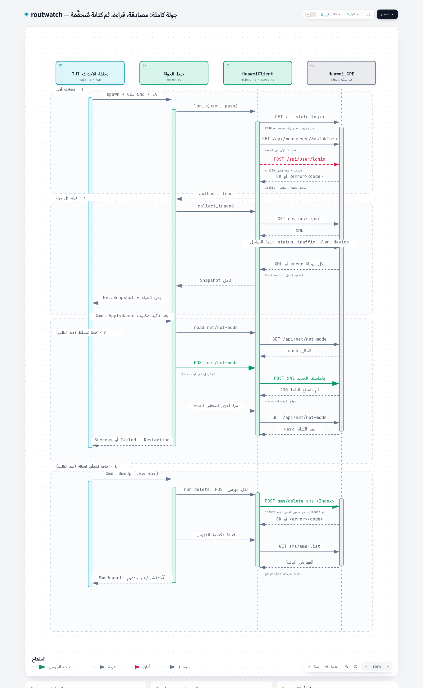

<p align="center">
  <h1 align="center">routwatch</h1>
  <p align="center"><strong>Huawei LTE/5G CPE manager in the terminal.</strong></p>
  <p align="center">
    
    
    
  </p>
</p>

routwatch is the fourth member of the `syswatch` / `netwatch` / `diskwatch`
family: same config file shape, same themes, same keys. It talks to a Huawei
CPE (tested on the H122-373, WEBUI 11.0.2.21) over its own HTTP API and gives
you signal, traffic, clients, bands, DNS and device state in one screen - plus
a headless mode for Waybar and scripts.


Every screenshot here is rendered from `fixtures/sample-snapshot*.json` with
`routwatch preview --ansi`, so it is synthetic: device names, MACs, WAN address and
identifiers are placeholders. The remaining seven sections are in
[`docs/screenshots/more/`](docs/screenshots/more).

## Install

| Route | Command |
|---|---|
| Arch package, no build | `curl -LO https://github.com/root-secyrity/routwatch/releases/download/v0.7.0/routwatch-0.7.0-1-x86_64.pkg.tar.zst && sudo pacman -U routwatch-0.7.0-1-x86_64.pkg.tar.zst` |
| Static musl binary | [routwatch-x86_64-linux-musl](https://github.com/root-secyrity/routwatch/releases/latest/download/routwatch-x86_64-linux-musl) - links nothing, runs on Arch, Debian, Ubuntu, Fedora, Alpine, Raspberry Pi OS |
| Any distro, from source | `git clone https://github.com/root-secyrity/routwatch.git && cd routwatch && sudo make install` |
| Windows 10/11, via WSL2 | no separate build: install the static binary inside WSL ([details](docs/platforms.md#windows)) |

The package is unsigned, so download the file before handing it to `pacman`
(passing a URL makes it look for a `.sig` that does not exist).
[`docs/install.md`](docs/install.md) has the rest: the musl build script, the
completions, the MSRV 1.88 floor and the glibc notes.

## Run it

```sh
routwatch --generate-config    # ~/.config/routwatch/config.toml at 0600
$EDITOR ~/.config/routwatch/config.toml
routwatch
```

Then `?` for the keys and `,` for the settings overlay. Reads are free; writes
need `a` then `y` (see [Safety](#safety)).

## Does it work with my router?

| Router | WebUI / firmware | What was verified |
|---|---|---|
| Huawei H122-373 | 11.0.2.21 | every section, the bands and DNS write path with its read-back, the headless commands, the report export |
| any other Huawei CPE | - | **untested** |

An untested model is not a refusal: the read path probes every endpoint and names
the ones the firmware refuses, so a panel says what is missing instead of
guessing, and the write path prints both sides before it sends anything. If you run
it on another model, open a
[model report](https://github.com/root-secyrity/routwatch/issues/new?template=model_report.yml)
with `routwatch doctor --json`; it becomes a mock profile and a test, so your
router ends up covered by CI. Distributions and optional helpers are listed in
[`docs/platforms.md`](docs/platforms.md).

## Visual maps

Two maps of the codebase, in English and Arabic: one for the architecture, one
for a single fetch cycle. Both are generated with Archify from the source at
commit `a2610eed97dbc879ebfa30f49ef38db7d05e3d4a`, and every claim drawn inside the HTML carries the source line it
came from.

| Arabic | English |
|---|---|
| [](docs/diagrams/routwatch-architecture.html) | [](docs/diagrams/routwatch-architecture.en.html) |
| [](docs/diagrams/routwatch-sequence.html) | [](docs/diagrams/routwatch-sequence.en.html) |

The HTML files are interactive and open locally: download the file and open it in
a browser, with no server, no install and no account. [`docs/diagrams/`](docs/diagrams)
lists all eight files.

## Documentation

Everything longer than this page lives in [`docs/`](docs/README.md), one file per
question.

| If you want to | Read |
|---|---|
| install it, and write the config file | [`docs/install.md`](docs/install.md) |
| know whether your router or distribution is covered | [`docs/platforms.md`](docs/platforms.md) |
| look up a key while the TUI is open | [`docs/keys.md`](docs/keys.md) |
| change bands, or save a band combination | [`docs/bands.md`](docs/bands.md) |
| put it in Waybar, or script against `--json` | [`docs/headless.md`](docs/headless.md) |
| change the colours | [`docs/themes.md`](docs/themes.md) |
| know what does not work, and why | [`docs/limits.md`](docs/limits.md) |
| know who wrote what | [`docs/credits.md`](docs/credits.md) · [`NOTICE`](NOTICE) |
| contribute, or read the promises a change must keep | [`CONTRIBUTING.md`](CONTRIBUTING.md) · [`docs/contracts.md`](docs/contracts.md) |

## Safety

- Reads are free; **writes are confirmed** and verified by reading the router back
  (`mask verified`), so a silent revert is visible.
- Band/DNS/restart changes need the in-TUI `a` → `y` confirmation, or
  `--allow-write` on the CLI. `--dry-run` prints the exact payload and sends nothing.
- Band changes drop the link for 10–30 seconds. The UI says so before you do it.

## Limits, the short list

- **5G per-field metrics can be empty** on some firmware: the signal panel shows
  the bars and says which `nr` fields did arrive rather than inventing dBm.
- **The budget starts at a baseline**: `budget_gb` is compared against traffic
  since a baseline that `b` resets and the billing cycle moves. The router's own
  month counter is used when the firmware answers it; otherwise the lifetime
  counters are. The per-day table only counts while routwatch runs.
- **Reports are redacted unless you ask**: `e` writes `0600` Markdown with IMEI,
  serial, WAN IP, MACs and SSIDs hidden, because these files get pasted in public.
- **The speed test measures this host, not the router**: `T` on Network runs a
  single plain-HTTP stream from this machine through the CPE, so the number
  includes the local Wi-Fi or LAN path and spends data that counts in the router's
  month total. It asks before it runs; `Esc` stops it.
- **The last runs are kept, and the panel says how many it shows**: each finished
  run is appended to `$XDG_DATA_HOME/routwatch/speed-history.jsonl` (`0600`): the
  Network tab shows the newest ten, the file keeps two hundred. The `SPEED` panel
  also lists the ping measured before the transfer and the one measured during it,
  so bufferbloat is visible next to the rate. `routwatch speedtest --history`
  prints the saved rows and `--no-save` keeps a run out of the file.
- **The signal itself is logged, one row a minute**: every command that collects
  appends to `$XDG_DATA_HOME/routwatch/signal-history.jsonl` (`0600`, last 1440
  rows), so a drop that happened while nobody watched still has a shape.
  `routwatch history --signal` prints the newest rows without touching the
  network or needing a config file; `ROUTWATCH_DISABLE_SIGNAL_LOG=1` turns the
  log off.

Fourteen more, including the `100006` band-write code, the small-terminal order and
the graph colour floor, are stated in [`docs/limits.md`](docs/limits.md). Nothing
there is a wish list: each entry is something a firmware or a terminal actually
did.

## Band scan

`routwatch scan --set 1,3 --set 1,28 --allow-write` applies one band set at a
time, waits for the link to carry an address again, runs one speed test on that
set, and at the end puts the mask the run started with back on the radio. The
table ranks the sets by measured download.

- It cuts the internet for every set: seconds to a minute each, and the whole run
  spends the data the speed tests spend.
- `--dry-run` prints the set list, the time ceiling and the data ceiling and sends
  nothing. Both ceilings are upper bounds: the settle wait ends as soon as an
  address returns, and a measurement that fails early spends less.
- `--settle` is a cap, not a duration.
- `Ctrl-C` restores the starting mask too. If the restore itself fails the run says
  which set is still on the radio and the exact command that puts it back.
- One number per set is not a verdict: the test measures this host's path through
  the router, not the WAN link alone, so a VPN or a second interface in that path
  makes every row say nothing about the set.

## New address

`routwatch ip renew --allow-write` drops the mobile data connection, brings it
back, and watches for the address the firmware reports. A changed address and the
same address are both exit 0: the ISP keeping the lease is a result, not a failure.

- It really cuts the link for a few seconds, and it is a write: without
  `--allow-write` the command refuses and names the flag.
- A connection that does not come back is exit 1 with the last attempt named, and
  the router stays reachable on its LAN address.
- **Not measured on hardware yet**: whether the H122-373 actually hands out a new
  address through this path is unverified. The write is covered by the mock and by
  the plan's rules, not by a live renew.

## Watching the link after a write

A band write restarts the radio, and a mask the tower does not like shows up as a
link that never comes back. `routwatch bands --set 1,3 --allow-write --watch 180`
holds the session open for three minutes after the write lands and reads the link
every five seconds.

- The terminal command stays attached; the TUI keeps the same offer in its status
  bar (`watching 172s, u reverts`) and closes it when the window ends.
- A session the restart dropped is rebuilt once with the same credentials, so the
  watch survives the radio going down and up.
- If the link has neither a state nor a WAN address for a full minute, the watch
  offers the previous mask once and waits for `y` on stdin. It never reverts on its
  own, and the window ending writes nothing.
- The TUI's `u` sends the four values the device carried before the apply (mode,
  bands, mask, option) back through the same write path, forced: by verdict time the
  device already reports the target mask, so an unforced write would be skipped.
- **Not measured on hardware yet**: a revert taken after a real dropped link is
  covered by the mock only.

## Development

`make build`, `make test`, `make lint`, `make fmt`; a change is ready when all four
are clean. The test count, the CI matrix and the rules for a change are in
[`CONTRIBUTING.md`](CONTRIBUTING.md). `docs/contracts.md` lists the promises a
future change could quietly break, each with the test that fails when it is
broken; the table is machine-checked by `src/contracts.rs`.

## Credits and prior art

routwatch follows three MIT tools by
[Matt Hartley (matthart1983)](https://github.com/matthart1983) -
[netwatch](https://github.com/matthart1983/netwatch),
[syswatch](https://github.com/matthart1983/syswatch) and
[diskwatch](https://github.com/matthart1983/diskwatch) - for the config shape,
the theme palettes and the `doctor --json` schema. The feature set and the router
knowledge come from **HManagerPy 2.1.0**, written by RoOt-SeC. The full
attribution, including the reproduced MIT text, is in [`NOTICE`](NOTICE) and
[`docs/credits.md`](docs/credits.md).

## License

MIT - see [LICENSE](LICENSE) and [NOTICE](NOTICE).
