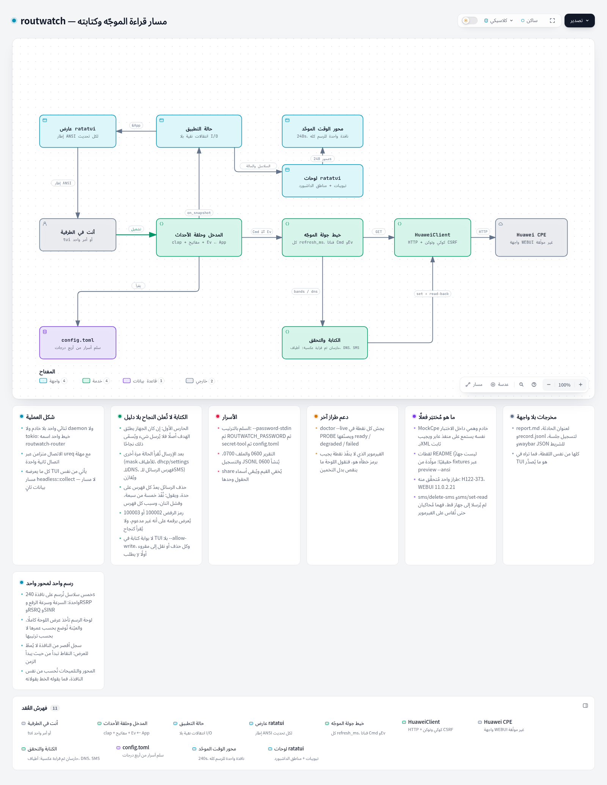

<p align="center">
  <h1 align="center">routwatch</h1>
  <p align="center"><strong>Huawei LTE/5G CPE manager in the terminal.</strong></p>
  <p align="center">
    
    
    
  </p>
</p>

routwatch is the fourth member of the `syswatch` / `netwatch` / `diskwatch`
family: same config file shape, same themes, same keys. It talks to a Huawei
CPE (tested on the H122-373, WEBUI 11.0.2.21) over its own HTTP API and gives
you signal, traffic, clients, bands, DNS and device state in one screen - plus
a headless mode for Waybar and scripts.


Every screenshot is rendered from `fixtures/sample-snapshot*.json` with
`routwatch preview --ansi`, so it is synthetic: device names, MACs, WAN address and
identifiers are placeholders. The other eight sections are in
[`docs/screenshots/`](docs/screenshots).

## Install

| Route | Command |
|---|---|
| Arch package, no build | `curl -LO https://github.com/root-secyrity/routwatch/releases/download/v0.10.2/routwatch-0.10.2-1-x86_64.pkg.tar.zst && sudo pacman -U routwatch-0.10.2-1-x86_64.pkg.tar.zst` |
| Static musl binary | [routwatch-x86_64-linux-musl](https://github.com/root-secyrity/routwatch/releases/latest/download/routwatch-x86_64-linux-musl) - links nothing, runs on Arch, Debian, Ubuntu, Fedora, Alpine, Raspberry Pi OS |
| Any distro, from source | `git clone https://github.com/root-secyrity/routwatch.git && cd routwatch && sudo make install` |
| Windows 10/11, via WSL2 | no separate build: install the static binary inside WSL ([details](docs/platforms.md#windows)) |

The package is unsigned, so download the file before handing it to `pacman`
(passing a URL makes it look for a `.sig` that does not exist).
[`docs/install.md`](docs/install.md) has the rest: the musl build script, the
completions, the MSRV 1.88 floor and the glibc notes.

## Run it

```sh
routwatch --generate-config    # ~/.config/routwatch/config.toml at 0600
$EDITOR ~/.config/routwatch/config.toml
routwatch
```

Then `?` for the keys and `,` for the settings overlay. Reads are free; writes
need `a` then `y` (see [Safety](#safety)).

It polls the router: this firmware has no push channel (seven stream candidates
answer `100003`), so the screen can never be fresher than one read. Reads are
grouped by how fast they answer - signal, status and traffic on the refresh
period, the client list every 30 s, the ten static documents every 60 s - and the
header shows an age for each group. What changes is written to an append-only log
under `$XDG_DATA_HOME/routwatch/events.jsonl`: band and DNS writes, IP renewals,
the WAN going down and coming back, a tier read that failed, and the signal
crossing into poor. The measured tail behind those numbers is in
[`docs/limits.md`](docs/limits.md).

Input is separate from that polling: a key is drawn in the pass that reads it
(p95 1.5 ms over a PTY, measured 2026-11-22), and the loop draws once per burst
of keys. The 30 s client read is a data delay, not a keyboard delay: browsing a
list moves a cursor over rows already in memory.

Every command closes its router session on the way out, error paths included:
the client logs in on a flag and `Drop` posts the logout while the flag is still
set, so a cron line that runs `status --json` every minute does not pile up
sessions. This firmware holds ten at once: from an idle start the eleventh
consecutive run answered `108003`, and twenty consecutive runs after the fix all
succeeded (measured 2026-11-22).

Measured values are drawn in one colour that is never a state colour: good, fair
and poor, the connection state and identifiers such as `B1` or a tab number keep
their own, and every fact is spelled out in words, so nothing is read from colour
alone.

The first frame is drawn before the process reads anything from disk, so the
screen answers at once and the panels say they are collecting until data lands.
The client order behind a redraw is derived once per change rather than once per
frame, which keeps a 40 client frame under half a millisecond of drawing work.

## Does it work with my router?

| Router | WebUI / firmware | What was verified |
|---|---|---|
| Huawei H122-373 | 11.0.2.21 | every section, the bands and DNS write path with its read-back, the headless commands, the report export |
| any other Huawei CPE | - | **untested** |

An untested model is not a refusal: the read path probes every endpoint and names
the ones the firmware refuses, so a panel says what is missing instead of
guessing, and the write path prints both sides before it sends anything. If you run
it on another model, open a
[model report](https://github.com/root-secyrity/routwatch/issues/new?template=model_report.yml)
with `routwatch doctor --json`; it becomes a mock profile and a test, so your
router ends up covered by CI. Distributions and optional helpers are listed in
[`docs/platforms.md`](docs/platforms.md).

## Visual maps

Two maps of the codebase, in English and Arabic: one for the architecture, one
for a fetch cycle and the two verified writes it can carry (a band mask, an SMS
delete). Both are generated with Archify from the source at
commit `89e79313001eaba7698d54b1da27babdd265521d`, and every claim drawn inside the HTML carries the source line it
came from.

| Arabic | English |
|---|---|
| [](docs/diagrams/routwatch-architecture.html) | [](docs/diagrams/routwatch-architecture.en.html) |
| [](docs/diagrams/routwatch-sequence.html) | [](docs/diagrams/routwatch-sequence.en.html) |

The HTML files are interactive and open locally: download the file and open it in
a browser, with no server, no install and no account. [`docs/diagrams/`](docs/diagrams)
lists all eight files.

## Documentation

Everything longer than this page lives in [`docs/`](docs/README.md), one file per
question.

| If you want to | Read |
|---|---|
| install it, and write the config file | [`docs/install.md`](docs/install.md) |
| know whether your router or distribution is covered | [`docs/platforms.md`](docs/platforms.md) |
| look up a key while the TUI is open | [`docs/keys.md`](docs/keys.md) |
| change bands, or save a band combination | [`docs/bands.md`](docs/bands.md) |
| put it in Waybar, or script against `--json` | [`docs/headless.md`](docs/headless.md) |
| change the colours | [`docs/themes.md`](docs/themes.md) |
| know what does not work, and why | [`docs/limits.md`](docs/limits.md) |
| audit what the router exposes, and catch a change | [`docs/privacy.md`](docs/privacy.md) |
| know who wrote what | [`docs/credits.md`](docs/credits.md) · [`NOTICE`](NOTICE) |
| contribute, or read the promises a change must keep | [`CONTRIBUTING.md`](CONTRIBUTING.md) · [`docs/contracts.md`](docs/contracts.md) |

## Safety

- Reads are free; **writes are confirmed** and verified by reading the router back
  (`mask verified`), so a silent revert is visible.
- Band/DNS/restart changes need the in-TUI `a` → `y` confirmation, or
  `--allow-write` on the CLI. `--dry-run` prints the exact payload and sends nothing.
- Pressing `d` (or `m`) opens a confirmation panel that lists the indexes it will
  touch and warns that a deleted message cannot be recovered; `y` sends, `n` or
  `Esc` cancels without a POST.
- The TUI itself starts read-only: `routwatch --allow-write` is what opens the write
  keys (Bands `a`, Device `b` and `W renew`, SMS `d` and `m`). Without it those
  keys answer `writes are off: start with --allow-write` and send nothing.
- Band changes drop the link for 10–30 seconds. The UI says so before you do it.
- `W renew` on Device drops the data connection for a few seconds on purpose, and the
  ISP may hand the same address back.

## SMS: read, mark read, delete

Section 6 lists the inbox with a cursor and a selection, and opens a message in a
wrapped reader underneath (`Enter`, `Esc` to close). Opening writes nothing: no
read receipt, no POST.

```sh
routwatch sms list                 # inbox, page by page, full text per row
routwatch sms list --folder draft --json --limit 50
routwatch sms read 4001            # the body on stdout, uncut
routwatch sms delete 4001 --allow-write --yes
routwatch sms delete --all --allow-write        # prints the plan, sends nothing
```

Delete and mark-read are the only SMS writes. Both need the same gate as band
changes: `--allow-write` on the CLI, `--dry-run` (or no `--yes`) to see the payload,
and `y` inside the TUI. Every delete is verified by re-reading the inbox and
reported per index, and a firmware that refuses the path is reported as
"unsupported (100003)", not as done.

## Privacy: watch a setting, not a guess

`privacy` is a read-only audit of remote management, DNS, firewall and the admin
surface. `--save` records the answers you accept (0600), `--diff` reads twice and
reports only a value both reads agree on, and `--watch 60` keeps asking on one
session. The four checks and the two rules behind a believable drift are in
[`docs/privacy.md`](docs/privacy.md).

## Incidents: what the logs support, and what they cannot

`incidents` turns the observation log, the signal log and the speed history into
windows of the same fault. It reads files only: no router, no clock, so the same
logs always produce the same list.

```sh
routwatch incidents list              # id, window, rows, confidence, no cause
routwatch incidents show wan-1795139583
routwatch report --incident wan-1795139583 --redact   # a pasteable document
```

Two limits are printed rather than hidden. Confidence is the count of rows that
agree (one row is low, two or three medium, four or more high), never a
probability. And no incident names a cause: the radio tier is read on its own
cadence, measured at p95 1748 ms and worst 2860 ms between samples on this
firmware, so two events closer than that cannot be ordered from their stamps.
When a pair falls inside that window the incident says so.

The dashboard's EVENTS panel shows the newest incidents the same way: an id, a
row count, a confidence, and `no cause`.

## What the firmware answers, and what it does not

`capabilities` records one state per endpoint: answered, refused with the firmware's
code, not served, or never tested, keyed by the firmware version it was measured on. It
is a record, never a permission: an untested endpoint does not hide a feature. `config`
keeps field names and salted fingerprints, never a value, and calls a change only when
two reads agree; there is no restore. `bands advise` ranks what the logs support, says
what the evidence cannot, and changes nothing.

```sh
routwatch capabilities --json            # the matrix, as recorded
routwatch capabilities --probe           # read it once, on one session
routwatch config snapshot                # fingerprints, never values
routwatch config diff                    # two reads, five change classes
routwatch bands advise --window 86400    # served bands, and what is missing
routwatch bands advise --scans scan.json # set advice, only from a measured scan
```

The four states, the two-read rule, the fingerprint, the smear and the four
confidence levels are stated in [`docs/limits.md`](docs/limits.md).

## Limits, the short list

- **5G per-field metrics can be empty** on some firmware: the signal panel shows
  the bars and says which `nr` fields did arrive rather than inventing dBm.
- **The Align tab averages reads, not time**: the tenth tab (`0`) reads as two columns,
  the state word with its arrow and the 15 s SINR average on the left (`12.0 dB`, unit
  included), the facts on the right (`SINR average · fair` from the advisor's own
  threshold, and `peak this session … ago`), over one of four words: `IMPROVING` or
  `DEGRADING` past a 3.6 dB deadband against the previous window, `HOLD HERE` inside it,
  and `NOT COMPARABLE YET` when there is no window to compare against (the tab then says
  how many seconds of reads it still needs). A session peak clears when the serving cell
  changes. The last 30 s are a strip of eight block levels scaled to its own window, with
  `30 s` at its left edge and `now` at its right. It is a reading,
  not a sweep: what a rotating antenna does to that average is unmeasured, so nothing on
  the tab is labelled as one. The engine behind it is held to a designed 60-read sweep
  (`fixtures/align-sweep.csv`), which covers the deadband crossing and the peak reset and
  says nothing about a measured curve.
- **The budget starts at a baseline**: `budget_gb` is compared against traffic
  since a baseline that `b` resets and the billing cycle moves. The router's own
  month counter is used when the firmware answers it; otherwise the lifetime
  counters are. The per-day table only counts while routwatch runs.
- **Reports are redacted unless you ask**: `e` writes `0600` Markdown with IMEI,
  serial, WAN IP, MACs and SSIDs hidden, because these files get pasted in public.
- **The speed test measures this host, not the router**: `T` on Network runs a
  single plain-HTTP stream from this machine through the CPE, so the number
  includes the local Wi-Fi or LAN path and spends data that counts in the router's
  month total. It asks before it runs; `Esc` stops it.
- **The last runs are kept, and the panel says how many it shows**: each finished
  run is appended to `$XDG_DATA_HOME/routwatch/speed-history.jsonl` (`0600`): the
  Network tab shows the newest ten, the file keeps two hundred. The `SPEED` panel
  also lists the ping measured before the transfer and the one measured during it,
  so bufferbloat is visible next to the rate. `routwatch speedtest --history`
  prints the saved rows and `--no-save` keeps a run out of the file.
- **SMS delete is verified, not assumed**: each index is posted on its own and the
  verdict comes from re-reading the inbox, so a refusal is listed with its code
  and a half-finished bulk delete says which rows failed.
- **A run holds one router session while it works**: the firmware keeps ten
  open at once and refuses the eleventh with `108003` (measured 2026-11-22). The
  process closes its own session on every exit path, but a `SIGKILL` cannot run
  that, so a killed run leaves its session until the firmware frees it, which
  took 259 s after the last read on this machine.
- **The cells catalog is a store, not a judgement**: `$XDG_DATA_HOME/routwatch/cells.json`
  (`0600`, at most 64 cells) keeps one row per serving cell this machine read, keyed by
  downlink ARFCN and PCI, and `routwatch cells list` prints them newest first. It never
  ranks them, never picks a best cell and never compares throughput across cells: that
  comparison has no measurement behind it yet, so the command prints what was seen and
  nothing more. The rules are in [`docs/limits.md`](docs/limits.md).
- **A cell change is logged, and can be compared with itself**: when the serving cell
  changes, the observation log gets one `cell` row after the new key is read twice in a
  row, and `routwatch cells changes` prints those rows. `routwatch compare --around ID`
  then compares that one cell with itself on either side of the event, over the signal log
  and the speed log already on disk: no router, no network, no cross-cell difference. It
  prints medians and a 10th percentile, calls a move real only past three measured
  standard deviations, and says `insufficient` instead of guessing when a side is thin.
  The observation log keeps recording when `ROUTWATCH_DISABLE_SIGNAL_LOG=1` mutes the
  minute log.
- **The month's burn can be read without the screen**: `routwatch budget` reads
  the local usage ledger and prints what the cycle used, the limit, the pace the
  ledger measured and how much of the window it was divided by; `--json` is the
  same figures for a script. It needs no config file and opens no router session,
  and it states the coverage instead of implying the rate is exact.
- **The signal is logged, one row a minute**: `$XDG_DATA_HOME/routwatch/signal-history.jsonl`
  (`0600`, three days of rows) gives a drop nobody watched a shape. `routwatch history
  --signal` prints it without touching the network; `ROUTWATCH_DISABLE_SIGNAL_LOG=1`
  turns the log off, and the cells catalog below with it. The same rows feed
  `routwatch antenna worth`, which says whether the cell is limited by how much
  arrives or by how clean it arrives, and the drift guard, which says when today
  is worse than this cell's own last days.

The rest, including the `100006` band-write code, the small-terminal order and the
retired graph styles, are stated in [`docs/limits.md`](docs/limits.md). Nothing there
is a wish list: each entry is something a firmware or a terminal actually did.

## Scan and a watched write

`routwatch scan --set 1,3 --set 1,28 --allow-write` applies one band set at a time,
runs a speed test on each, and puts the mask the run started with back on the radio
at the end or on `Ctrl-C`. `routwatch bands --set 1,3 --allow-write --watch 180`
holds the session open for three minutes after the write lands and reads the link
every five seconds; the TUI keeps the same offer in its status bar, and `u` sends
the four values the device carried before the apply back, forced.

- Both cut the link and spend data. `--dry-run` prints the set list with the time
  and data ceilings and sends nothing; `--settle` is a cap, not a duration.
- One number per set is not a verdict: the test measures this host's path through
  the router, so a VPN or a second interface in that path measures itself.
- **Measured on a WL1H122M (firmware 11.0.2.21(H329SP1C7002)), 2026-11-23**: five
  `ip renew` runs, each with `--allow-write`; the data connection went down and came
  back 2 to 4 seconds later every time and the ISP handed the same address back in
  all five. The `LinkDown` and `NoAddress` paths are still covered by the mock only,
  and a band revert taken after a real dropped link has not been run live.

How each one behaves when it goes wrong is in [`docs/bands.md`](docs/bands.md) and
[`docs/limits.md`](docs/limits.md).

## Development

`make build`, `make test`, `make lint`, `make fmt`; a change is ready when all four
are clean. The test count, the CI matrix and the rules for a change are in
[`CONTRIBUTING.md`](CONTRIBUTING.md). `docs/contracts.md` lists the promises a
future change could quietly break, each with the test that fails when it is
broken; the table is machine-checked by `src/contracts.rs`.

## Credits and prior art

routwatch follows three MIT tools by
[Matt Hartley (matthart1983)](https://github.com/matthart1983) -
[netwatch](https://github.com/matthart1983/netwatch),
[syswatch](https://github.com/matthart1983/syswatch) and
[diskwatch](https://github.com/matthart1983/diskwatch) - for the config shape,
the theme palettes and the `doctor --json` schema. The feature set and the router
knowledge come from **HManagerPy 2.1.0**, written by RoOt-SeC. The full
attribution, including the reproduced MIT text, is in [`NOTICE`](NOTICE) and
[`docs/credits.md`](docs/credits.md).

## License

MIT - see [LICENSE](LICENSE) and [NOTICE](NOTICE).
