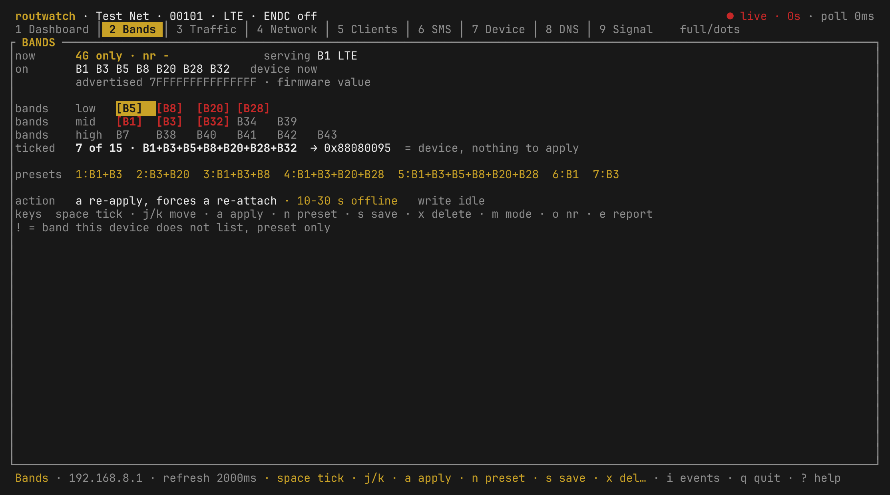

# Bands, with merge presets

This file answers: how do I tick bands, and how do I keep a combination I use a
lot?

Select several bands (`space`), save the combination as a preset (`s`), and cycle
the ready-made ones with `n`. Nothing is sent until `a` and `y`.

The grid is grouped `low` / `mid` / `high` by frequency, so dropping every low
band is visible before it costs you range; the band the radio is on is
underlined, and the panel says when your tick already equals the device.

A tall panel also names the link's own numbers (MHz, bandwidth, TM, PCI), the
secondary DL carrier when one is up, the last apply with its verdict, and the NR
band when the firmware reports one. When the tick set leaves out the band
carrying the link, the panel says so before `a`, and `u` puts the previous mask
back in the tick list without sending anything.

Presets live in `~/.config/routwatch/config.toml` (`[[app.presets]]`). No
`presets` key means the five built-ins; `presets = []` means you deleted them and
mean it.

A band write can answer with an undefined code even when it lands. How the tool
reads the verdict in that case is the second bullet of [limits.md](limits.md).

Back: [README](../README.md) · [all docs](README.md)
